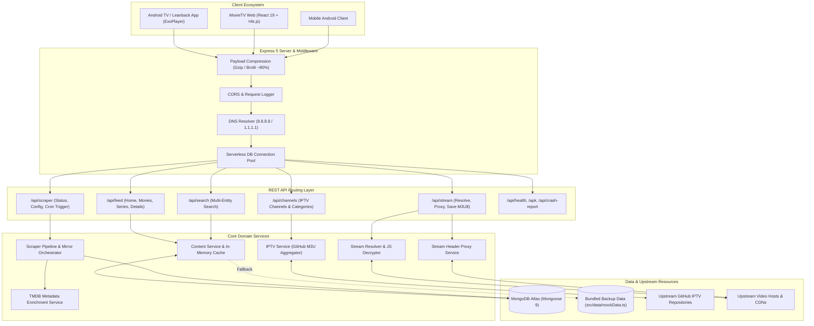
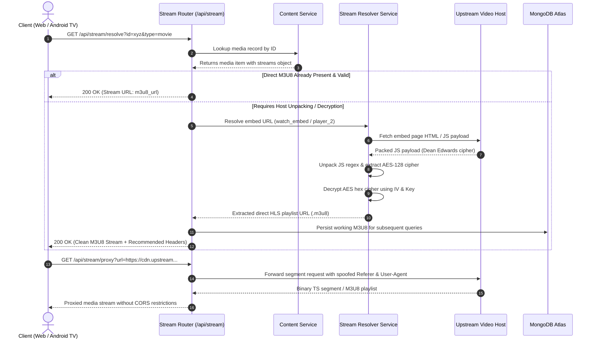

<div align="center">


# MovieTV — Stateless Streaming Aggregator Backend

**High-Performance REST API & Media Aggregator for Android TV, Web, and Mobile Streaming Platforms**

[](https://github.com/dhrub4545/movieTV-backend)
[](https://opensource.org/licenses/ISC)
[](https://nodejs.org/)
[](https://www.typescriptlang.org/)
[](https://expressjs.com/)
[](https://www.mongodb.com/)
[](https://vercel.com/)

---

### 🔗 Companion Repositories & Clients

| Component | Link | Description |
| :--- | :--- | :--- |
| 🌐 **Web Application** | [](https://github.com/dhrub4545/movieTV-web) | Modern React 19 + Hls.js cinematic streaming client |
| 📱 **Android TV & Mobile App** | [](/apk) | Native client with Leanback UI & ExoPlayer support |

</div>

---

## 📌 Executive Summary & Problem Solved

Video streaming aggregators face steep operational hurdles: flaky scrapers, dynamic stream token expiration, restrictive anti-hotlinking headers, ISP-level DNS blocks on MongoDB SRV records, and heavy JSON payloads that choke low-memory Android TV streaming sticks (Fire TV, Mi Box, Chromecast with Google TV).

**MovieTV Backend** delivers an industrial-grade, stateless streaming architecture engineered specifically for speed, resilience, and serverless scalability:
1. **Zero-Lag Feed Delivery**: Employs real-time Gzip/Brotli payload compression that slashes feed payload sizes by **~80%**, ensuring instant catalog scrolling on 1GB RAM Android TV devices.
2. **Dynamic Stream Resolution & Decryption**: Resolves live streaming sources across multiple mirror providers, unpacks obfuscated JavaScript embeds, decrypts AES-128-CBC payloads, and outputs clean direct `.m3u8` playlists.
3. **Resilient DNS & Serverless Persistence**: Solves ISP and Windows DNS timeouts on MongoDB Atlas SRV clusters via pre-configured Google/Cloudflare DNS resolver fallback, paired with global Mongoose connection caching.
4. **Unified Media Aggregation**: Synchronizes Indian regional cinema, global Hollywood films, episodic web series, and 800+ Live IPTV channels into a cohesive, normalized REST API.

---

## 🌟 Key Features

- 🎬 **Unified Media Feeds**: Paginated collections for Bollywood, South Indian (Tamil, Telugu, Malayalam, Kannada), Punjabi, Hollywood, and Web Series with full season and episode trees.
- 📺 **800+ Live IPTV Channels**: Automated ingestion from curated GitHub M3U repositories, categorized by `Sports`, `News`, `Movies`, `Entertainment`, `Music`, and `Kids`.
- 🔄 **Dynamic Stream Resolver & Header Proxy**: Unpacks JavaScript packer ciphers (Dean Edwards), decrypts cipher keys, extracts high-speed HLS links, and proxies streams with referer/user-agent spoofing.
- ⚡ **80% JSON Compression**: Integrated Express compression middleware optimizing bandwidth consumption across mobile and TV networks.
- 🌐 **SRV DNS Overrides**: Automatic fallback to Google (`8.8.8.8`) and Cloudflare (`1.1.1.1`) DNS resolvers to avoid DNS SRV failures during Atlas connection handshakes.
- 🛡️ **Serverless Ready (Vercel)**: Global connection caching across warm/cold serverless invocations with automatic fallback to bundled JSON mock data if the database is unreachable.
- 🤖 **Automated Scraper Pipeline**: Scheduled content fetching with Vercel Cron compatibility (`GET /api/scraper/trigger`) and runtime configuration updates.
- 📱 **Android TV Support Infrastructure**: Native endpoints for remote crash logging (`POST /api/crash-report`) and direct APK browser downloading (`GET /apk`).

---

## 🏗️ System Architecture

The following diagram demonstrates how MovieTV Backend processes client queries, resolves media streams, coordinates with upstream CDNs, and persists state in MongoDB Atlas:



---

## 🔄 Sequence Diagram: Stream Resolution & Decryption

The sequence diagram below reveals how the backend resolves an obfuscated video host URL into a clean HLS `.m3u8` stream:



---

## 💻 Tech Stack

| Domain | Technology | Version | Purpose |
| :--- | :--- | :--- | :--- |
| **Runtime** | Node.js | `>=20.0.0` | Asynchronous server-side JavaScript runtime |
| **Language** | TypeScript | `5.7.0` | Type-safe enterprise application code |
| **Framework** | Express.js | `5.3.0` | Next-generation routing framework with native promise handling |
| **Database** | MongoDB / Mongoose | `9.11.2` | Document storage with schema typing and serverless connection reuse |
| **Compression** | compression | `1.8.2` | Gzip and Deflate middleware reducing network payload by ~80% |
| **HTTP Client** | Axios | `1.20.0` | Upstream scraper requests, IPTV M3U fetching, and TMDB calls |
| **Dev Execution** | tsx | `4.19.2` | High-speed TypeScript execution and watch mode |
| **Testing** | Node Test Runner & Supertest | `Node 20+` / `7.3.1` | Native integration test execution |
| **Deployment** | Vercel Serverless | V2 Platform | Stateless edge deployment with zero server maintenance |

---

## 📂 Repository Structure

```text
movieTV-backend/
├── api/
│   └── index.ts                      # Vercel serverless entrypoint
├── assets/
│   └── hero.png                      # MovieTV branding banner
├── scripts/
│   └── cleanStaleTokens.js           # Utility to clean up expired stream URLs
├── src/
│   ├── data/
│   │   └── mockData.ts               # Standalone fallback seed data for cold-start resilience
│   ├── routes/
│   │   ├── channelRoutes.ts          # IPTV live channel listing and category filters
│   │   ├── feedRoutes.ts             # Home carousels, movies, series, and details
│   │   ├── scraperRouter.ts          # Scraper controls, mirror configuration, and Vercel Cron
│   │   ├── searchRoutes.ts           # Multi-entity search across movies and web series
│   │   └── streamRoutes.ts           # Stream resolution, stream proxy, and M3U8 saver
│   ├── services/
│   │   ├── contentService.ts         # Feed caching, pagination, and category filtering
│   │   ├── greenmotorsResolver.ts    # Specialized extractor for dynamic video hosts
│   │   ├── iptvService.ts            # GitHub M3U IPTV fetcher and parser
│   │   ├── m3u8Extractor.ts          # Generic regex and JavaScript embed unpacker
│   │   ├── proxyService.ts           # HTTP stream proxy with header rewrite capabilities
│   │   ├── scraperPipelineService.ts # Scheduled catalog scraper and mirror orchestrator
│   │   ├── streamResolverService.ts  # Master stream resolution router
│   │   └── tmdbService.ts            # TMDB metadata and artwork enrichment
│   ├── app.ts                        # Express application setup, middlewares, and routes
│   ├── db.ts                         # MongoDB connection pool, DNS overrides & Mongoose schemas
│   ├── seedDb.ts                     # Database seeding script
│   ├── server.ts                     # HTTP server listener for standalone Node.js mode
│   └── types.ts                      # Shared TypeScript interfaces (Movie, Series, Channel)
├── test/
│   └── backend.test.ts               # Integration test suite for core endpoints
├── .env.example                      # Template environment variable configurations
├── package.json
├── scraper_config.json               # Configured scraper mirror endpoints
├── tsconfig.json                     # TypeScript compilation settings
└── vercel.json                       # Serverless routing, timeout limits, and headers
```

---

## 🛠️ Local Setup & Installation

### Prerequisites
- **Node.js**: `v20.x` or higher ([Download Node.js](https://nodejs.org/))
- **MongoDB**: Active [MongoDB Atlas](https://www.mongodb.com/atlas) cluster URI (or local MongoDB)

### Step-by-Step Installation

1. **Clone the Repository**:
   ```bash
   git clone https://github.com/dhrub4545/movieTV-backend.git
   cd movieTV-backend
   ```

2. **Install Dependencies**:
   ```bash
   npm install
   ```

3. **Configure Environment Variables**:
   Copy `.env.example` to `.env`:
   ```bash
   cp .env.example .env
   ```
   Add your MongoDB connection string and options:
   ```ini
   PORT=5000
   MONGO_URI=mongodb+srv://<username>:<password>@cluster0.mongodb.net/movieTV?retryWrites=true&w=majority
   GITHUB_IPTV_URL=https://iptv-org.github.io/iptv/countries/in.m3u
   TMDB_API_KEY=your_optional_tmdb_key_here
   ```

4. **Start in Development Mode (Live Reloading)**:
   ```bash
   npm run dev
   ```
   The server will start on `http://localhost:5000`.

5. **Build and Run for Production**:
   ```bash
   npm run build
   npm start
   ```

6. **Execute Integration Tests**:
   ```bash
   npm test
   ```

---

## 🔐 Environment Variables

| Variable | Required | Default | Description |
| :--- | :---: | :--- | :--- |
| `PORT` | No | `5000` | Port for the standalone Express HTTP server |
| `MONGO_URI` / `MONOGO_URI` | **Yes** | `—` | MongoDB Atlas SRV connection string with credentials |
| `GITHUB_IPTV_URL` | No | Curated URL | Custom upstream GitHub M3U playlist URL for Live TV |
| `TMDB_API_KEY` | No | `—` | The Movie Database (TMDB) API key for metadata & poster enrichment |

---

## 📡 Complete API Reference

### 1. Feed & Catalog Routes (`/api/feed`)

| Endpoint | Method | Parameters | Description |
| :--- | :---: | :--- | :--- |
| `/api/feed/home` | `GET` | None | Curated home feed with hero carousel, trending movies, and top series |
| `/api/feed/latest` | `GET` | `page`, `limit` | Chronological feed of latest media releases |
| `/api/feed/movies` | `GET` | `page`, `limit`, `search` | Paginated movie catalog with real-time text query filtering |
| `/api/feed/movies/indian` | `GET` | `page`, `limit` | Filtered releases from Bollywood, South Indian, and Punjabi cinema |
| `/api/feed/movies/global` | `GET` | `page`, `limit` | Filtered releases from Hollywood and international cinema |
| `/api/feed/series` | `GET` | `page`, `limit` | Paginated web series catalog |
| `/api/feed/movie/:id` | `GET` | `id` (path) | Full details for a single movie, including stream metadata |
| `/api/feed/series/:id` | `GET` | `id` (path) | Full details for a web series, including all seasons and episodes |

### 2. Live TV Channels (`/api/channels`)

| Endpoint | Method | Parameters | Description |
| :--- | :---: | :--- | :--- |
| `/api/channels` | `GET` | `category`, `refresh` | List 800+ Live IPTV channels (pass `refresh=true` to force upstream GitHub sync) |
| `/api/channels/categories` | `GET` | None | List available Live TV categories (`Sports`, `News`, `Movies`, etc.) |
| `/api/channels/:id` | `GET` | `id` (path) | Retrieve stream details for a specific channel ID |

### 3. Stream Resolution & Proxying (`/api/stream`)

| Endpoint | Method | Parameters | Description |
| :--- | :---: | :--- | :--- |
| `/api/stream/resolve` | `GET` | `id`, `type`, `season`, `episode` | Dynamically resolve and unpack `.m3u8` stream for movies or series |
| `/api/stream/proxy` | `GET` | `url`, `referer` | Reverse stream proxy forwarding HLS video packets with spoofed headers |
| `/api/stream/save-m3u8` | `POST` | `id`, `type`, `m3u8_url`, `season`, `episode` | Persist a validated working M3U8 back into MongoDB |

### 4. Search & Scraper (`/api/search`, `/api/scraper`)

| Endpoint | Method | Parameters | Description |
| :--- | :---: | :--- | :--- |
| `/api/search` | `GET` | `q` (query) | Unified fuzzy search across all movies and web series titles |
| `/api/scraper/status` | `GET` | None | Inspect status, last run timestamp, and active scraper mirror health |
| `/api/scraper/config` | `GET` | None | Fetch current scraper mirror configuration (`scraper_config.json`) |
| `/api/scraper/config` | `POST` | Body: `{ baseUrl }` | Dynamically update scraper upstream mirror endpoint |
| `/api/scraper/trigger` | `GET/POST`| None | Trigger catalog scraper pipeline run (Vercel Cron compatible) |

### 5. Utility & Android Integration

| Endpoint | Method | Description |
| :--- | :---: | :--- |
| `/api/health` | `GET` | System health check, version, and server timestamp |
| `/apk` | `GET` | Download the compiled Android TV / Mobile `.apk` directly to mobile devices |
| `/api/crash-report` | `POST` | Ingests crash telemetry and stack traces from native Android clients |
| `/web` & `/` | `GET` | Serves the companion React 19 web interface if bundled |

---

## 🚀 Production Deployment

### Option A: Vercel Serverless (Recommended)

This repository includes a production-ready `vercel.json` and serverless bridge (`api/index.ts`):

1. Go to your [Vercel Dashboard](https://vercel.com) and click **Add New Project**.
2. Select `movieTV-backend`.
3. In **Environment Variables**, set:
   - `MONGO_URI`: Your MongoDB Atlas SRV URI.
4. Click **Deploy**.
5. Vercel automatically exposes all endpoints under `/api/*`.

### Option B: Docker Container

Create a `Dockerfile` in the root directory:

```dockerfile
FROM node:20-alpine AS builder
WORKDIR /app
COPY package*.json tsconfig.json ./
RUN npm ci
COPY src/ ./src/
RUN npm run build

FROM node:20-alpine
WORKDIR /app
COPY package*.json ./
RUN npm ci --only=production
COPY --from=builder /app/dist ./dist
COPY scraper_config.json ./
EXPOSE 5000
ENV NODE_ENV=production
CMD ["node", "dist/server.js"]
```

Build and launch:
```bash
docker build -t movietv-backend .
docker run -d -p 5000:5000 --env-file .env --name movietv-api movietv-backend
```

### Option C: Standalone Node.js with PM2

```bash
npm run build
npm install -g pm2
pm2 start dist/server.js --name "movietv-api" -i max
pm2 save
pm2 startup
```

---

## 🛡️ Security, Performance & Best Practices

1. **SRV DNS Overrides**:
   Many Windows environments and regional broadband ISPs reject or rate-limit DNS SRV record lookups (`_mongodb._tcp...`). MovieTV forces Node.js to use Google and Cloudflare Public DNS resolvers on boot, preventing startup handshake errors:
   ```typescript
   try {
     dns.setServers(['8.8.8.8', '1.1.1.1']);
   } catch { /* Ignore if restricted */ }
   ```

2. **Payload Compression (~80% Reduction)**:
   Android TV devices frequently operate over congested Wi-Fi bands. All feed JSON responses pass through high-speed Gzip/Brotli compression, reducing a 250KB multi-season catalog response down to ~35KB.

3. **Serverless Connection Pooling**:
   When hosted on Vercel, serverless lambdas can spawn dozens of concurrent instances. MovieTV utilizes global connection caching (`global._mongoConn`) with `serverSelectionTimeoutMS: 5000` to prevent connection spikes and maintain sub-50ms warm response times.

4. **Cold-Start Resilience**:
   If the database is temporarily unreachable, the `contentService` seamlessly falls back to bundled seed data (`src/data/mockData.ts`), ensuring Android TV users never encounter a blank screen.

5. **Anti-Hotlinking Header Proxying**:
   Third-party video hosts employ anti-leeching mechanisms that reject requests missing valid `Referer` or `User-Agent` headers. The backend's `/api/stream/proxy` service rewrites these headers on the fly, enabling video players to stream media unblocked.

---

## 👥 Authors & Licensing

Developed by the **MovieTV Engineering Team** ([@dhrub4545](https://github.com/dhrub4545)).  
Distributed under the **ISC License**. See `package.json` for details.
